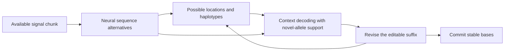

# Improve context feedback by identifying the limiting error mechanism

This is a proposed research program dated 2026-10-24, based on source HEAD `050bc68cae40edda96c83257c79ec5db49404659`. The goal remains Jake's original idea: infer genomic location while calling a molecule, then use that context to resolve uncertain DNA without erasing private variants. The recommendation is to establish where useful alternatives exist, improve targeting and contextual decisions, and then justify larger search or live integration from a measured failure. There is substantial untested design space. Its size is not evidence of a large achievable accuracy gain.

This document changes no decoder, frozen policy, result, stock control, or PR. No build, native execution, GPU execution, biological scoring, checkpoint admission, or host-lock acquisition ran for this synthesis. All experiments below are proposals. The existing decoder experiment remains separate from catalogue-bridge acceptance.

## What the current experiment establishes

The [frozen v2 report](context-feedback-v2.md) records relative invariant error-rate reductions of 0.6814% and 0.5068% against native HAC v6. Both miss the unchanged 1% promotion target. The two domains are masks over the same development parents. They are not independent biological confirmations. Their integer error counts change from 8,785 to 8,725 and from 3,939 to 3,919. Rate denominators also change, so those count differences alone do not reproduce the relative rate reductions.

The [empirical audit](../logs/context-feedback/next-research-20261024/empirical.md) changes the interpretation of scope. The 311 admitted centers cover 6,353 of 1,432,768 native bases, or 0.4434%. Their nominal genomic unions overlap 590 and 282 native error bases under the fixed baseline mapping, or 6.716% and 7.159% of matched errors. These regions are error-enriched. Whole-base coverage is therefore not an error-reduction ceiling. Neither are the overlapping error counts attainable gains. Reference-disagreement nomination also includes genuine variants. Some candidate alternatives may be unsupported, and remapping complete outputs can move error placement and exposure.

The historical selector starts with native substitutions, insertions, and deletions relative to the reference. It requires exact ten-base anchors and hash-orders eligible proposals before a 512-window cap. Attachment produces 451 planned windows. Original graph exclusions remove 120, and revised guard exclusions remove twenty more. This is not an uncertainty controller. Approximately 93% of matched baseline errors lie outside the admitted center unions, but their recoverability is unknown. These facts motivate a targeting experiment rather than a promise of proportional improvement.

Within the admitted frames, the current search has a different limitation. Its conditioned branch supplies 6,631 sequences absent from escape finalists and native, yet every raw contextual winner already occurs in the escape finalists. Final reranking and context during search produce identical calls. Both beams prune, so this does not prove global optimality. It does show that changing intermediate beams has added no winning sequence in this experiment. Increasing the center-length cap has still less support because neither arm hits that cap. [Saved audit](../logs/context-feedback/next-research-20261024/empirical-audit.json).

The gate counts also need care. There are 109 raw alternatives to reference-free: 32 accepted, thirty blocked by margin, and 47 blocked by signal deficit. The other 202 frames choose the same sequence before gates. Counting all 232 margin fallbacks as rejected useful corrections would be incorrect. Whether any blocked alternative is biologically helpful remains an oracle question.

Variant evidence is limited. The full outputs retain 829 baseline ALT calls, but no actually edited center overlaps their tested footprints. The private diagnostic preserves 26 unambiguous cases by abstaining. It does not demonstrate safe correction at variant sites. In withheld private query 21, the raw winner deletes a genuine C. The saved candidate scores give a neural-score loss of 0.43538991034512 and a contextual objective gain of only 0.06461008965488. The frozen 0.5 margin prevents that deletion. Under fixed scores, a margin at or below that gain would admit it. [Actual candidates](../results/context-feedback/v2-private-1/decoded-withheld-21/result.json), [gate implementation](../tools/context_decoder/src/guarded.cpp).

## Prioritize experiments that separate the possible causes

The three research slices agree on the main uncertainties but differ in ordering. The [online slice](../logs/context-feedback/next-research-20261024/online-literature.md) puts larger supported windows first. The [empirical](../logs/context-feedback/next-research-20261024/empirical.md) and [model](../logs/context-feedback/next-research-20261024/model.md) slices prioritize an oracle before new decoding. The recommendation here follows the oracle first. Current evidence does not yet distinguish missing sequences from wrong ranking or conservative decisions. Larger windows become the next intervention when that audit identifies boundary or context limitations. This is a methodological judgment, not proof supplied by reviewer agreement.

| Order | Concrete experiment | Evidence required to continue | Falsifiable stopping condition |
| --- | --- | --- | --- |
| 1 | Candidate-support and target-error audit on retained artifacts | Useful alternatives classified by support, ranking, gates, and exclusions | Stop inferring headroom when truth or score custody cannot establish it |
| 2 | Uncertainty nomination and selectively larger supported regions | Additional qualified error exposure with useful variant-preserving alternatives | Stop widening when new regions lack score coverage or add harm without useful corrections |
| 3 | Normalized mutation-aware graph scoring, followed by a separate calibrated action model | Better correction coverage at the declared harmful-edit risk on new partitions | Stop if apparent benefit depends on private-allele erasure or complete abstention |
| 4 | Joint search with the same objective, or a declared causal replay | Useful winning strings absent from the late arm, or a distinct latency requirement | Stop claiming a search advantage if all raw winners remain available to late scoring |
| 5 | Independent-molecule sample graph, then targeted signal-model work | Added information or an identified observation-model failure | Stop if evidence leaks across molecules, collapses rare alleles, or fails matched controls |

The first unit needs no new neural producer. Enumerate native, escape finalists, conditioned-only finalists, and projected graph strings. There are 39,808 escape finalist entries and 6,631 additional conditioned-only candidates across 311 frames, before native and graph additions. Evaluate them under fixed boundaries and masks. Keep a masked local-error oracle separate from an exact phased-haplotype oracle. Ambiguous truth must remain unresolved. Truth may construct diagnostic comparisons and evaluate outputs, but must never enter inference records or choose a deployable winner.

For each frame, ask whether a useful sequence is present, whether the graph supports it, whether the objective ranks it first, and whether the gates accept it. Audit all 77 blocked alternatives and the 32 accepted alternatives as helpful, harmful, neutral, or unresolved. Include substitutions, insertions, deletions, and ALT consequences. A diagnostic curve over saved scores can reveal tradeoffs. It does not validate a new threshold.

The same unit should extend the exclusion and targeting ledger using native alignments and retained metadata. Separate cap losses, exact-anchor losses, missing graph context, unsafe boundaries, and missing score custody. Compare actual graph context with reference-only, disabled, and predeclared wrong-context controls on the same candidates. This tests whether graph information helps beyond generic reference attraction. Its work is short sequence comparison and metadata inspection, not a new beam run.

The metadata inventory finds 1,557 score files across all 64 parents, totaling 6,407,427,934 bytes, with complete declared DGM and DGP chunk-index accounting. This makes broader reuse plausible. Payloads were not newly read, hashed, or qualified. Score headers, interpretation, interval ownership, and source closure must be checked before broader neural uncertainty analysis. Metadata completeness does not prove a valid whole-read editable score representation. [Availability inventory](../logs/context-feedback/next-research-20261024/empirical-score-availability.json).

## Replace nearest-path attraction with a testable uncertainty model

Current context uses negative minimum Levenshtein distance to deduplicated projected strings. It carries no location posterior, orientation probability, haplotype weight, mutation process, or panel-missing probability. A single compatible path determines the bonus. This is a nearest-path regularizer, not a measured genomic posterior. [Context potential](../tools/context_decoder/src/decoder.cpp), [model derivation](../logs/context-feedback/next-research-20261024/model.md).

Model A should first score the existing candidate set with a weighted mixture over location, orientation, and coherent haplotype. A normalized mutation process permits substitutions, insertions, deletions, and termination between the panel and the molecule. A full-support background component permits DNA absent from every panel path. Biological mutation and sequencing error need distinct parameters. Duplicating a graph record must not double prior probability. Multiple edit histories need marginalization rather than an arbitrary best edit path.

The neural score `L` sums CRF alignment mass for a fixed guarded sequence. Its name does not establish `P(raw signal | DNA)`. Under a conditional interpretation, a normalized graph distribution can enter as a declared contextual feature or product of experts. Exact Bayesian prior replacement would additionally require a defensible source sequence prior and assumptions about the signal channel. Neither is established here. A source-prior correction cannot be invented by subtracting k-mer frequencies.

A mapper posterior derived from the same signal is also not an independent observation. Multiplying it into a neural posterior as an independent likelihood risks self-reinforcement. Flanking evidence can help locate a center, but encoder receptive fields and read-level nuisance variables complicate independence. Use a defined joint conditional model or a calibrated residual approximation and test it. High location confidence never implies that the central allele is represented in the panel.

Model C is the practical decision competitor. Keep proposal generation fixed and estimate expected correction benefit and harmful-edit risk from inference-available features. Candidates include neural-score differences, location entropy, graph disagreement, edit class, run length, boundary support, and missing-panel mass. Use a small model and separate fitting, calibration, and confirmation partitions. The current 64 parents and 26 unambiguous private cases do not provide adequate rare-allele risk calibration. Add representative variant-bearing cases where a proposed correction actually changes the allele or its surroundings. Report correction coverage beside harm. A model that accepts nothing can be safe without improving calling.

Keep the existing score as the historical arm. Compare weighted marginal graph scoring first, then add background mass, then test the decision model separately. Do not change targeting, prior, beam width, and acceptance threshold together. The frozen gate algebra illustrates why attribution matters. If `delta` is neural-score change and `k` is nearest-path distance improvement, acceptance requires `delta >= -0.5` and `delta + 0.5*k >= 0.5`. A one-edit contextual improvement with strictly negative `delta` cannot pass. That is a quantifiable property to investigate, not an instruction to lower the margin.

## Make localization a persistent belief, then prove search earns its cost

The intended online system should maintain probabilities over location, orientation, haplotype, and an unknown-location state. Several regions of one molecule share these latent variables. Their DNA cannot independently select whichever genome copy gives each local center the largest bonus. Distant flanks can resolve a repeat copy and change the interpretation of an uncertain center. Coherent haplotype state can reject incompatible allele combinations. These constraints add a mechanism absent from independent minimum-distance center bonuses.

This mechanism can be tested through late scoring before a joint decoder. Given identical evidence and factors, exact late marginalization and exact joint-state inference produce the same sequence posterior. A joint decoder can help finite search retain a useful sequence, expose latent-state posteriors, or meet a different latency contract. Joint state alone adds no observation. Force-score a validated useful sequence absent from both beams before widening. If it still loses the objective or gates, wider search does not fix the decision.

Only a demonstrated support failure warrants a small width comparison, such as 128, 256, and 512, with matched late and joint arms. A graph transducer then needs probability-preserving hidden-state merging, termination, and protection against duplicate silent-step interleavings between graph deletions and CRF stays. Tiny exhaustive examples should prove late/joint equality before biological runs. No runtime forecast follows from the existing full-unit duration because it includes custody, construction, decoding, tracing, and checkpoint reuse.

The intended internal feedback loop is:

This diagram is a proposed dependency structure, not a measured accuracy or latency result.

Streaming adds a separate contract. Retain a committed prefix and an editable suffix with bounded revisions. Obtain location proposals asynchronously, retain uncertain alternatives, and commit only after declared evidence and delay conditions. A blocked or late proposal must permit reference-free completion. Measure location readiness, stable output delay, revisions, queue tails, memory, transfer, and complete throughput.

Internal feedback can operate before final whole-read BAM emission. Jake's scientific goal does not require a public partial-output API. The next architecture must also replace the fixed native four-base initial-state assumption carefully. Carry soft CRF state and graph continuity across owned intervals, and avoid multiplying overlapping chunk marginals as independent evidence. These are proposed qualification requirements, not defects demonstrated by the current local experiment.

Saved full-chunk tensors cannot establish raw-prefix causality by deleting future rows. The pinned encoder reverses recurrent layers, so early scores can contain later signal. True prefix evaluation requires encoding only available samples with declared lookahead. The v2 right guard and backward guide also use future information. Completed-chunk replay can test scheduling, but its availability horizon must be named. [Pinned LSTM source](https://github.com/nanoporetech/dorado/blob/8b8fc5d36a9c0baab262a743cb175b5878e38ca6/dorado/nn/LSTMStack.cpp).

## Add information only with independent controls

An independent-molecule sample graph is the strongest long-term information proposal. Build and phase context on one molecule partition, freeze it, and call another. Exclude the target molecule, its chunks, split children, complement, and derived consensus. An online version uses only earlier molecules with graph versions frozen in time. Preserve rare-mixture and novel branches. Adequate independent coverage and phasing remain unverified requirements.

[HERRO and Dorado Correct](https://software-docs.nanoporetech.com/dorado/latest/secondary/correct/) provide an external correction baseline and a complementary product. They use all-versus-all read alignment and haplotype-aware deep correction after calling, accept FASTQ, and emit FASTA. The documentation recommends long reads and roughly 30-fold coverage. Their outcomes cannot be transferred to a live context decoder. [Ratatosk](https://link.springer.com/article/10.1186/s13059-020-02244-4) uses colored short-read graph information to avoid incorrect haplotypes. It supports haplotype-aware constraints as prior art, with different inputs and older error profiles.

[RADIAN](https://proceedings.mlr.press/v200/sneddon22a/sneddon22a.pdf) supplies direct prior-feedback precedent through conditional mRNA language guidance during CTC search. RNA structure and its acknowledged SNP risk prevent transferring the result to private human DNA. The online research note also identifies reference-corrected therapeutic-RNA retraining. Known manufactured RNA targets do not establish safe labels for unknown genomic alleles. Signal mappers propose locations rather than corrected bases.

Signal realignment, explicit run-length models, sequence-conditioned correction, and retraining come after the oracle identifies missing useful support or poor signal discrimination. Retained tensors cannot test a new encoder. Reference-derived training labels risk teaching away private alleles. Keep unchanged stock HAC controls and eventually a matched HAC/SUP comparison. Improvement over this HAC baseline would not establish general state of the art. Consensus accuracy and individual-molecule basecalling also require separate endpoints.

## Acceptance must test edits where variants are exposed

Preserve the frozen 1% target in both domains, strictly negative technical parent/block upper bounds, complete parent accounting, and adequate per-class ALT support. New exploratory endpoints supplement those criteria. They do not retroactively change the old result. Technical resampling over observed flowcells is not population uncertainty.

Measure allele loss among accepted edits at variant-bearing centers, with denominators for eligible, proposed, accepted, and harmed events. Report independent parents and event sites separately. Include private SNVs, insertions, deletions, homopolymer lengths, wrong locations, repeats, structural variation, and absent panel alleles. Distinguish ordinary correction from preservation by abstention. Test neutrality, unavailable context, graph duplication, wrong orientation, and missing-location mass.

Partition by donor and genomic region before fitting. Keep all derivatives of a physical molecule together. Audit donor and close-relative contributions to panels. Exposed HG002 remains development evidence. HG005 must not select candidates, thresholds, graph parameters, or stopping decisions. Stronger model selection needs genuinely fresh confirmation, rather than repeated optimization of the same two masks.

The immediate deliverable should therefore be a candidate/error atlas and a predeclared decision on which intervention it justifies. Explain the Number changed the denominator interpretation. Fix Root Causes requires identifying targeting, support, ranking, or gate failures before adding machinery. Laziness Protocol favors retained-candidate scoring before joint search. These choices narrow the first experiment while preserving the larger online objective.

Sources consulted include local source, retained artifacts, the three linked research slices, and primary papers or official implementation documentation. The coordinator's Google Drive searches for `nanopore` and `basecaller` returned no matches. No project chat, observability, error-tracker, or analytics evidence informed this synthesis. This is a focused investigation, not an exhaustive literature review. Some publisher bodies were inaccessible; their unverified details do not support new numerical claims here.
