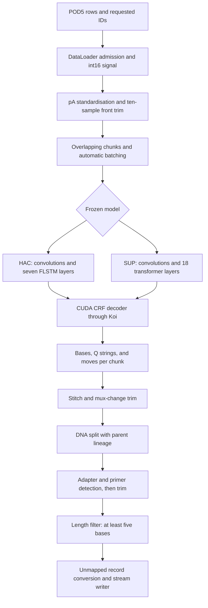

# Dorado's stock simplex code path

## Overview

Dorado turns calibrated nanopore current into overlapping neural-network chunks, decodes each chunk into bases and qualities, joins them, then splits and trims reads before writing sequencing records. The two frozen controls share that pipeline but use different networks. HAC v6.0.0 has seven factorised LSTM layers. SUP v5.2.0 has an 18-layer transformer. Both feed the CUDA decoder. The relevant construction points are [`create_simplex_pipeline`][pipeline], [`load_crf_model`][model-dispatch], and [`create_decoder`][decoder-choice].

This explanation traces public source commit [`8b8fc5d36a9c0baab262a743cb175b5878e38ca6`][source] for this exact argument shape, with separate numeric tokens:

```sh
dorado basecaller MODEL POD5 --read-ids IDS --device cuda:0 --batchsize 0 --min-qscore 0 --trim all -v
```

`MODEL` is the explicit frozen HAC or SUP directory. The statements below describe source behavior and observed configuration values. They do not establish which hardware-dependent kernels executed, binary equivalence, complete input processing, biological accuracy, or performance. The separate [source-build qualification](source-build-notes.md) uses unchanged upstream input, declared vendor patches, and an isolated supported host compiler. Reading this code does not certify that build's runtime.

## Key concepts

- A `SimplexRead` carries signal, sequence, qualities, moves, calibration, and lineage through the pipeline. Signal samples, neural timesteps, and bases are different coordinate systems. A move vector connects neural timesteps to emitted bases. [`DecodedChunk`][decoded-type] contains the decoder's sequence, quality string, and moves.
- A chunk is an overlapping signal interval. A batch groups work for a runner. With variable chunks, a batch's capacity need not equal its number of real chunks. [`BasecallerNode::basecall_worker_thread`][chunk-worker] packs that work.
- `CudaModelRunner` owns staging buffers and a CUDA stream. Multiple runners on a device share a `CudaCaller`, which queues model and decoder work. [`create_basecall_runners`][runners] constructs them.
- A split child is an output interval of an already basecalled read. Splitting does not run the network again. [`create_simplex_pipeline`][pipeline] places DNA splitting after basecalling.

## How it works



The graph is the configured simplex path. Modified-base calling, RNA handling, barcode classification, alignment, and output-directory pass/fail routing are not selected by this command. Pipeline construction is split between [`create_simplex_pipeline`][pipeline] and [`basecaller.cpp`'s downstream node construction][downstream].

### Input admission precedes signal processing

`load_read_list` reads exact newline-delimited strings into a set. It does not strip whitespace or normalize UUIDs. An empty supplied file selects no reads. [`DataLoader::should_process_pod5_row`][admission] checks each row's formatted UUID against the allowed set before signal extraction. The unrestricted loader enumerates files and rows rather than using the separate by-channel planned traversal. A requested ID absent from the files does not itself cause a missing-ID exception. See [`load_read_list`][read-list] and [`load_reads_unrestricted`][unrestricted].

For an admitted row, `process_pod5_thread_fn` reads complete signal into a CPU `int16` tensor and carries calibration scale, offset, open-pore level, sample rate, and flow-cell metadata. POD5 errors on this path log and return null; `wait_and_process_futures` skips null results. Consequently, a successful process exit alone cannot prove that every requested parent entered inference. These are separate admission and extraction boundaries. [`process_pod5_thread_fn`][load-signal], [`wait_and_process_futures`][loader-forward].

### Calibration determines what the network sees

Both frozen configs declare DNA at 5,000 samples per second, pA scaling, and standardisation. HAC uses mean 94 and standard deviation 24. SUP uses mean 93.69239463939118 and standard deviation 23.506745239082388. These are observed model-file values, pinned below.

`ScalerNode::input_thread_fn` combines the POD5 calibration and model constants. With ADC sample `x`, calibration scale `s`, offset `o`, model mean `m`, and standard deviation `d`, the normalized value is `(s * (x + o) - m) / d`. If a measured open-pore level is present and the flow-cell product has a known expected level, it additionally subtracts `(measured - expected) / d`. The expected-level map is public source; actual input metadata and the resulting correction were not measured here. [`ScalerNode` scaling and metadata adjustment][scaling], [`expected open-pore levels`][open-pore].

The conversion computes in float32 and stores float16 CPU signal. Standardised DNA then loses ten leading samples when the signal is longer than ten samples. This signal trim is independent of `--trim all`, which controls later sequence trimming. The stored scaling metadata does not by itself establish that the optional open-pore correction was zero. [`shift_scale_tensor_i16_to_f16_inplace`][conversion], [`ScalerNode` front trim][signal-trim].

### Model files select both architecture and chunk geometry

The architecture parser recognizes the transformer section in TOML. The HAC and SUP names alone do not select the network. [`is_tx_model_config`][architecture-test], [`load_model_config` architecture dispatch][architecture]. The frozen model files contain these values:

| Property | HAC v6.0.0 | SUP v5.2.0 |
| --- | --- | --- |
| Convolution channels | 1 → 16 → 16 → 1024 | 1 → 64 → 64 → 128 → 128 → 512 |
| Sequence network | Seven alternating-direction FLSTM layers, size 1024, inner dimension 128 | 18 transformer layers, dimension 512, eight heads, feedforward dimension 2048, attention window [127,128] |
| Head | 1024 → 128 bottleneck and tanh-scaled CRF head | Learned 2× time upsampling and linear scaled CRF head |
| CRF state length | 4 | 5 |
| Effective output stride | Six signal samples per timestep | Six signal samples per timestep after upsampling |
| Chunk length and overlap | 12288 and 600 samples | 12288 and 600 samples |
| Per-base Q scale and bias | 1.02 and -0.3 | 1.05 and 0.3 |

The observed files are `models/dna_r10.4.1_e8.2_400bps_hac@v6.0.0/config.toml`, lines 7–137, and `models/dna_r10.4.1_e8.2_400bps_sup@v5.2.0/config.toml`, lines 5–123. Their SHA-256 values are respectively `e550ccbedb68ed74d6ee88e2f510adf33c52a1c868bd5e3a2bfbb7dfe6154c3f` and `ad82d7c369deddc0d1e69367302b8e002c306a9770ae4304a3cbb70715fcce49`. [The asset lock](../provenance/assets.lock.json) pins their vendor archives, [HAC][hac-archive] and [SUP][sup-archive], with archive hashes `5812471f26a59a717f8d56c2dffe5db603426cbf7701f9361ad3ad1f84ee51f6` and `94ddebdee5db58676f447cf09a6710ff6da3b5cba1fabead867d8672255bc73e`. These configuration observations do not validate weight contents or training ancestry.

`CRFModelImpl::run_koi` implements the HAC CUDA path through convolutions, recurrence, and head. SUP's `TxModelImpl::forward` calls convolutions, transformer, upsampling, and head. Fixed input `[N,1,12288]` therefore yields source-derived score shapes `[N,2048,1024]` for HAC and `[N,2048,4096]` for SUP. These channels are CRF transition scores, not four independent base probabilities. Variable chunks use packed layouts and auxiliary chunk tables, so tensor dimension `N` need not count reads. [`CRFModelImpl`][hac-forward], [`TxModelImpl::forward`][sup-forward], [`HAC dimension derivation`][score-dimensions], [`SUP stride and dimensions`][sup-dimensions], [`CUDADecoder` chunk tables][decode-layout].

Only explicitly supplied batch arguments override model parameters. Since this command omits `--chunksize` and `--overlap`, the model's 12288 and 600 values survive rather than the parser's displayed defaults. Model TOML batch size is ignored. `--batchsize 0` requests automatic selection using available memory and cached timings or startup model-forward benchmarks. It does not identify a fixed batch size. [`get_batch_params`][batch-args], [`get_optional_argument`][optional-arg], [`BatchParams` loading and merging][batch-config], [`CudaCaller::determine_batch_dims`][autobatch].

Variable chunking is enabled by default but requires model, build, and GPU support. For these shapes, the Koi gates require GPU architecture major at least eight, and FLSTM additionally requires at least nine multiprocessors. Orin builds exclude this feature. HAC can use balanced variable intervals; SUP uses full maximum intervals followed by a tail. The chunk worker repeat-pads a slice to the required granularity, despite a chunk-generator comment mentioning zero padding. SUP also inserts separate zeros at packed convolution boundaries. None of these branches establishes the path selected on the actual GPU. [`CLI defaults`][cli-switches], [`check_variable_chunk_sizes_supported`][vcs], [`Koi capability helpers`][koi-gates], [`chunk generators`][chunks], [`basecall_worker_thread`][chunk-worker], [`CudaModelRunner` buffers][runner-buffer].

### CUDA decoding crosses an opaque dependency boundary

`CudaCaller::cuda_thread_fn` runs the model and `CUDADecoder::beam_search_part_1`, then synchronizes the stream. Its `model_decode_ms` scope includes both operations. `call_chunks` copies output back and invokes decoder part two, which constructs bases, Phred+33 quality strings, and moves for each chunk. [`cuda_thread_fn`][cuda-task], [`call_chunks`][cpu-decode], [`beam_search_part_2`][decode-unpack].

The public CUDA wrapper calls Koi's `host_back_guide_step`, `host_beam_search_step`, `host_compute_posts_step`, and `host_run_decode`. Default beam width is 32, beam cut 100, and blank score 2. Model Q scale and bias are passed to these kernels; `--min-qscore` changes later filtering, not search or per-base Q generation. Exact pruning, ties, posterior-to-Q formula, and rounding remain inside Koi. The separate public CPU beam implementation is not evidence of the GPU algorithm. [`DecoderOptions`][decoded-type], [`CudaCaller` decoder options][decoder-options], [`CUDA Koi calls`][decode-koi], [`filter construction`][downstream].

The same distinction applies to neural arithmetic. Public FLSTM code shows quantization before an external factorised-LSTM call. Transformer code gates tiled, INT8, and FP8 paths by capabilities and options. Describing the entire computation as FP16 would lose those distinctions. Koi 0.7.5 is pinned as an imported library or internal-source build; Torch also crosses a linked-library boundary. The trace does not expose their kernel bodies or prove numerical parity with public fallback equations. [`FLSTMStack` optimized path][flstm-koi], [`TxEncoderStack`][tx-stack], [`FP8 gate`][fp8], [`Koi dependency`][koi-build], [`Torch dependency`][torch-build].

### Stitching and read processing change output length and identity

`working_reads_manager` waits for all expected chunks and restores their read order. `stitch_chunks` divides overlaps at their signal midpoint, maps those cuts through moves, and concatenates retained sequence and qualities. It does not align overlapping strings or choose the higher-quality base. It also removes padded tails and partial-stride overhang where applicable. [`working_reads_manager`][stitch-call], [`stitch_chunks`][stitch].

Before downstream splitting, `BasecallerNode` applies mux-change trimming to qualifying end-reason reads. This suffix trim is independent of adapter trim selection. DNA splitting then runs `DuplexReadSplitter` in simplex mode. Its pore/adapter detection removes spacer intervals and retains positive sequence and signal spans. Duplex-only split finders are inactive. [`BasecallerNode` downstream handoff][mux-call], [`mux-change trim`][mux-trim], [`simplex split finders`][split-finders], [`subreads` retained ranges][split-ranges].

Split children retain ancestor identity, sliced signal, bases, qualities, and moves. Their UUID is derived from parent UUID and decimal child index. A split can retain only one child and still change its UUID, as an upstream fixture explicitly covers. BAM records carry `pi:Z` for the parent and `sp:i` for the original-signal split offset. A parent missing from QNAME can therefore still have output lineage. [`splitter::subread`][subread], [`DuplexReadSplitter::split`][child-ids], [`one-child fixture`][one-child], [`simplex BAM tags`][bam-tags].

`--trim all` enables adapter and primer detection here. Barcode classification additionally requires a kit argument, which is absent. The detector and trimmer intersect retained intervals and slice sequence, qualities, moves, and signal. Crossed detection intervals can leave a read untrimmed; the detector's `num_untrimmed_short_reads` counter does not count discarded reads. [`adapter and primer detector`][adapter], [`TrimmerNode`][trimmer], [`Trimmer` slicing][trim-slice].

`ReadFilterNode` runs after trimming. At `--min-qscore 0`, its Q rejection condition is disabled, but the CLI still supplies minimum length five and an empty ID exclusion set. Outputs of zero through four bases are discarded; five bases pass this gate. Thus a split child can disappear after the split boundary, and all children of a parent can in principle fail the length gate. That is a source-derived possibility, not a diagnosis of a biological input. [`ReadFilterNode` predicate][filter], [`CLI filter parameters`][downstream], [`default minimum length`][minlength].

Mean read Q differs from per-base Q. The config parser defaults `mean_qscore_start_pos` to 60. `calculate_mean_qscore` skips that DNA prefix when enough qualities remain, then averages error probabilities and converts the result back to Phred. BAM `qs:f` is calculated after trimming. A consequential source inference remains untested: `shallow_copy_read` creates a fresh object without copying `mean_qscore_start_pos`, whose object default is zero. Newly created split children therefore appear to use all retained qualities, while unchanged reads retain the 60-base setting. A synthetic native fixture is needed before relying on this behavior operationally. It does not enable Q rejection at min-Q zero. [`Q start default`][q-default], [`read Q calculation`][mean-q], [`probability mean`][q-mean], [`shallow_copy_read`][copy], [`object default`][q-object-default].

### Output counters describe several different populations

`extract_sam_lines` constructs one unmapped record per surviving simplex message and checks name, sequence, and quality consistency. With no output directory, the stream writer chooses SAM for a terminal, uncompressed BAM for a pipe, and BAM for ordinary redirected output. Exact stdout topology is part of the output contract. Normal completion drains the pipeline; this command does not select fast time-limited termination. [`extract_sam_lines`][bam-convert], [`HtsFileWriterBuilder`][writer-mode], [`normal drain`][drain].

The basecaller counts stitched parent bases and samples before mux trimming, splitting, adapter trimming, and filtering. Split-node counters stop at the split boundary. `num_reads_split` counts multiple-output events and misses one-child renames. The writer's `split_reads_written` counts records with `pi`, not parents. Its `unique_simplex_reads_written`, displayed as "Simplex reads basecalled", increments only for child index zero with an unmapped or primary record. If child zero fails the length gate and child one survives, real parent lineage can exist without this counter increasing. [`basecaller counters`][stitch-call], [`split counters`][split-counters], [`writer counter conditions`][writer-counters], [`progress summary`][progress].

There is also a source-level output error-detection gap. `StreamHtsFileWriter::handle` ignores `HtsFile::write`'s return, although the underlying function returns `sam_write1`'s status. `HtsFileWriter::process` then updates statistics after handling. Counters alone therefore do not prove physical BAM completeness. This is not evidence that an I/O error occurred. Output acceptance needs retained process status, stderr, BAM integrity, and actual record inventory. [`stream write`][stream-write], [`write return`][write-return], [`statistics update order`][write-stats].

## Where things live

The smallest useful navigation map follows the processing boundaries:

- [`cli/cli_lib/basecaller.cpp`][downstream] resolves arguments, creates runners and nodes, and drains the pipeline.
- [`data_loader/DataLoader.cpp`][load-signal] and [`read_pipeline/nodes/ScalerNode.cpp`][scaling] own signal admission and normalization.
- [`config/BasecallModelConfig.cpp`][architecture], [`basecall/model/CRFModel.cpp`][hac-forward], and [`basecall/model/TxModel.cpp`][sup-forward] connect exported model descriptions to runtime networks.
- [`basecall/CudaCaller.cpp`][cuda-task], [`CudaModelRunner.cpp`][runner-buffer], and [`basecall/decode/CUDADecoder.cpp`][decode-koi] own staging, scheduling, inference, and decode handoffs.
- [`read_pipeline/base/stitch.cpp`][stitch], [`splitter/DuplexReadSplitter.cpp`][child-ids], and [`demux/Trimmer.cpp`][trim-slice] own transformations after decoding.
- [`ReadFilterNode.cpp`][filter], [`read_pipeline/base/messages.cpp`][bam-convert], and [`hts_writer`][writer-counters] own final admission, record construction, and accounting.

## Gotchas

The historical 17 HG005 absences have no per-parent cause established by this trace. No HG005 inputs or results were analyzed for this explanation. Loader omission, lineage renaming, final length rejection, process interruption, and physical output failure belong to different evidence categories. Finding a possible code path does not show that a particular parent took it.

Research interventions belong at explicit boundaries, with their stock controls preserved. The following are places to measure or later change behavior, not an algorithm proposal:

- At loader and scaler output, retain requested versus admitted identities, input sample count, calibration, and front-trim offset. The invariant is traceable input membership and signal coordinates. The relevant contracts are [`loader admission`][admission] and [`scaler output`][signal-trim].
- At chunk generation and decoder output, retain intervals, stride, padding, tensor interpretation, equal sequence/Q lengths, and moves-to-base counts. Fixed and variable packing require separate checks. The contracts are [`chunk generators`][chunks], [`decoder unpacking`][decode-unpack], and [`stitching`][stitch].
- At splitting and trimming, retain ancestor UUID, child index, original-signal offset, and consistent signal/base/move slices. Explicitly check the mean-Q prefix setting when children are created. The contracts are [`subread slicing`][subread], [`split validation`][split-validation], and [`copy semantics`][copy].
- At filtering and writing, distinguish rejected child messages, surviving records, and unique parent lineage. Count actual output parents by `pi` when present and QNAME otherwise, rather than assuming the progress counter is a parent inventory. The contracts are [`filter predicate`][filter], [`BAM lineage tags`][bam-tags], and [`writer counters`][writer-counters].

Future candidates need separate paths, a predeclared hypothesis and endpoint, and development/validation evidence before selection. HG005 must not select candidates. Source reading identifies these intervention points but establishes no bottleneck, speedup, accuracy gain, GPU parity, or completed-runtime acceptance. The ignored trace notes at `logs/source-qualification-20261023/trace-signal-inference.md` and `trace-decoding-yield.md` preserve the broader source inventory and prospective probes.

[source]: https://github.com/nanoporetech/dorado/tree/8b8fc5d36a9c0baab262a743cb175b5878e38ca6
[pipeline]: https://github.com/nanoporetech/dorado/blob/8b8fc5d36a9c0baab262a743cb175b5878e38ca6/dorado/api/pipeline_creation.cpp#L63-L118
[model-dispatch]: https://github.com/nanoporetech/dorado/blob/8b8fc5d36a9c0baab262a743cb175b5878e38ca6/dorado/basecall/crf_utils.cpp#L167-L198
[decoder-choice]: https://github.com/nanoporetech/dorado/blob/8b8fc5d36a9c0baab262a743cb175b5878e38ca6/dorado/basecall/decode/Decoder.cpp#L15-L25
[decoded-type]: https://github.com/nanoporetech/dorado/blob/8b8fc5d36a9c0baab262a743cb175b5878e38ca6/dorado/basecall/include/basecall/DecodedChunk.h#L9-L23
[chunk-worker]: https://github.com/nanoporetech/dorado/blob/8b8fc5d36a9c0baab262a743cb175b5878e38ca6/dorado/read_pipeline/nodes/BasecallerNode.cpp#L420-L491
[runners]: https://github.com/nanoporetech/dorado/blob/8b8fc5d36a9c0baab262a743cb175b5878e38ca6/dorado/api/runner_creation.cpp#L100-L138
[downstream]: https://github.com/nanoporetech/dorado/blob/8b8fc5d36a9c0baab262a743cb175b5878e38ca6/dorado/cli/cli_lib/basecaller.cpp#L605-L684
[read-list]: https://github.com/nanoporetech/dorado/blob/8b8fc5d36a9c0baab262a743cb175b5878e38ca6/dorado/utils/basecaller_utils.cpp#L7-L26
[admission]: https://github.com/nanoporetech/dorado/blob/8b8fc5d36a9c0baab262a743cb175b5878e38ca6/dorado/data_loader/DataLoader.cpp#L95-L139
[unrestricted]: https://github.com/nanoporetech/dorado/blob/8b8fc5d36a9c0baab262a743cb175b5878e38ca6/dorado/data_loader/DataLoader.cpp#L329-L359
[load-signal]: https://github.com/nanoporetech/dorado/blob/8b8fc5d36a9c0baab262a743cb175b5878e38ca6/dorado/data_loader/DataLoader.cpp#L141-L198
[loader-forward]: https://github.com/nanoporetech/dorado/blob/8b8fc5d36a9c0baab262a743cb175b5878e38ca6/dorado/data_loader/DataLoader.cpp#L529-L602
[scaling]: https://github.com/nanoporetech/dorado/blob/8b8fc5d36a9c0baab262a743cb175b5878e38ca6/dorado/read_pipeline/nodes/ScalerNode.cpp#L185-L234
[open-pore]: https://github.com/nanoporetech/dorado/blob/8b8fc5d36a9c0baab262a743cb175b5878e38ca6/dorado/read_pipeline/nodes/ScalerNode.cpp#L117-L138
[conversion]: https://github.com/nanoporetech/dorado/blob/8b8fc5d36a9c0baab262a743cb175b5878e38ca6/dorado/torch_utils/tensor_utils.cpp#L76-L122
[signal-trim]: https://github.com/nanoporetech/dorado/blob/8b8fc5d36a9c0baab262a743cb175b5878e38ca6/dorado/read_pipeline/nodes/ScalerNode.cpp#L236-L262
[architecture]: https://github.com/nanoporetech/dorado/blob/8b8fc5d36a9c0baab262a743cb175b5878e38ca6/dorado/config/BasecallModelConfig.cpp#L510-L513
[architecture-test]: https://github.com/nanoporetech/dorado/blob/8b8fc5d36a9c0baab262a743cb175b5878e38ca6/dorado/config/BasecallModelConfig.cpp#L346-L349
[hac-archive]: https://cdn.oxfordnanoportal.com/software/analysis/dorado/dna_r10.4.1_e8.2_400bps_hac@v6.0.0.zip
[sup-archive]: https://cdn.oxfordnanoportal.com/software/analysis/dorado/dna_r10.4.1_e8.2_400bps_sup@v5.2.0.zip
[hac-forward]: https://github.com/nanoporetech/dorado/blob/8b8fc5d36a9c0baab262a743cb175b5878e38ca6/dorado/basecall/model/CRFModel.cpp#L31-L145
[sup-forward]: https://github.com/nanoporetech/dorado/blob/8b8fc5d36a9c0baab262a743cb175b5878e38ca6/dorado/basecall/model/TxModel.cpp#L20-L47
[score-dimensions]: https://github.com/nanoporetech/dorado/blob/8b8fc5d36a9c0baab262a743cb175b5878e38ca6/dorado/config/BasecallModelConfig.cpp#L238-L309
[sup-dimensions]: https://github.com/nanoporetech/dorado/blob/8b8fc5d36a9c0baab262a743cb175b5878e38ca6/dorado/config/BasecallModelConfig.cpp#L434-L462
[decode-layout]: https://github.com/nanoporetech/dorado/blob/8b8fc5d36a9c0baab262a743cb175b5878e38ca6/dorado/basecall/decode/CUDADecoder.cpp#L20-L90
[batch-args]: https://github.com/nanoporetech/dorado/blob/8b8fc5d36a9c0baab262a743cb175b5878e38ca6/dorado/cli/cli_lib/basecaller.cpp#L207-L213
[optional-arg]: https://github.com/nanoporetech/dorado/blob/8b8fc5d36a9c0baab262a743cb175b5878e38ca6/dorado/cli/cli_lib/include/cli/utils/cli_utils.h#L143-L146
[batch-config]: https://github.com/nanoporetech/dorado/blob/8b8fc5d36a9c0baab262a743cb175b5878e38ca6/dorado/config/BatchParams.cpp#L25-L105
[autobatch]: https://github.com/nanoporetech/dorado/blob/8b8fc5d36a9c0baab262a743cb175b5878e38ca6/dorado/basecall/CudaCaller.cpp#L516-L665
[vcs]: https://github.com/nanoporetech/dorado/blob/8b8fc5d36a9c0baab262a743cb175b5878e38ca6/dorado/api/runner_creation.cpp#L24-L60
[cli-switches]: https://github.com/nanoporetech/dorado/blob/8b8fc5d36a9c0baab262a743cb175b5878e38ca6/dorado/cli/cli_lib/basecaller.cpp#L1184-L1192
[koi-gates]: https://github.com/nanoporetech/dorado/blob/8b8fc5d36a9c0baab262a743cb175b5878e38ca6/dorado/nn/KoiUtils.cpp#L9-L40
[chunks]: https://github.com/nanoporetech/dorado/blob/8b8fc5d36a9c0baab262a743cb175b5878e38ca6/dorado/read_pipeline/base/chunk.cpp#L11-L149
[runner-buffer]: https://github.com/nanoporetech/dorado/blob/8b8fc5d36a9c0baab262a743cb175b5878e38ca6/dorado/basecall/CudaModelRunner.cpp#L13-L54
[cuda-task]: https://github.com/nanoporetech/dorado/blob/8b8fc5d36a9c0baab262a743cb175b5878e38ca6/dorado/basecall/CudaCaller.cpp#L729-L744
[cpu-decode]: https://github.com/nanoporetech/dorado/blob/8b8fc5d36a9c0baab262a743cb175b5878e38ca6/dorado/basecall/CudaCaller.cpp#L281-L289
[decode-unpack]: https://github.com/nanoporetech/dorado/blob/8b8fc5d36a9c0baab262a743cb175b5878e38ca6/dorado/basecall/decode/CUDADecoder.cpp#L136-L197
[decoder-options]: https://github.com/nanoporetech/dorado/blob/8b8fc5d36a9c0baab262a743cb175b5878e38ca6/dorado/basecall/CudaCaller.cpp#L138-L145
[decode-koi]: https://github.com/nanoporetech/dorado/blob/8b8fc5d36a9c0baab262a743cb175b5878e38ca6/dorado/basecall/decode/CUDADecoder.cpp#L93-L132
[flstm-koi]: https://github.com/nanoporetech/dorado/blob/8b8fc5d36a9c0baab262a743cb175b5878e38ca6/dorado/nn/FLSTMStack.cpp#L165-L233
[tx-stack]: https://github.com/nanoporetech/dorado/blob/8b8fc5d36a9c0baab262a743cb175b5878e38ca6/dorado/nn/TxModules.cpp#L805-L916
[fp8]: https://github.com/nanoporetech/dorado/blob/8b8fc5d36a9c0baab262a743cb175b5878e38ca6/dorado/nn/TxModules.cpp#L434-L440
[koi-build]: https://github.com/nanoporetech/dorado/blob/8b8fc5d36a9c0baab262a743cb175b5878e38ca6/cmake/Koi.cmake#L40-L92
[torch-build]: https://github.com/nanoporetech/dorado/blob/8b8fc5d36a9c0baab262a743cb175b5878e38ca6/cmake/Torch.cmake#L49-L87
[stitch-call]: https://github.com/nanoporetech/dorado/blob/8b8fc5d36a9c0baab262a743cb175b5878e38ca6/dorado/read_pipeline/nodes/BasecallerNode.cpp#L221-L270
[stitch]: https://github.com/nanoporetech/dorado/blob/8b8fc5d36a9c0baab262a743cb175b5878e38ca6/dorado/read_pipeline/base/stitch.cpp#L18-L107
[mux-call]: https://github.com/nanoporetech/dorado/blob/8b8fc5d36a9c0baab262a743cb175b5878e38ca6/dorado/read_pipeline/nodes/BasecallerNode.cpp#L267-L270
[mux-trim]: https://github.com/nanoporetech/dorado/blob/8b8fc5d36a9c0baab262a743cb175b5878e38ca6/dorado/read_pipeline/base/read_utils.cpp#L68-L165
[split-finders]: https://github.com/nanoporetech/dorado/blob/8b8fc5d36a9c0baab262a743cb175b5878e38ca6/dorado/splitter/DuplexReadSplitter.cpp#L534-L598
[split-ranges]: https://github.com/nanoporetech/dorado/blob/8b8fc5d36a9c0baab262a743cb175b5878e38ca6/dorado/splitter/DuplexReadSplitter.cpp#L496-L531
[subread]: https://github.com/nanoporetech/dorado/blob/8b8fc5d36a9c0baab262a743cb175b5878e38ca6/dorado/splitter/splitter_utils.cpp#L34-L109
[child-ids]: https://github.com/nanoporetech/dorado/blob/8b8fc5d36a9c0baab262a743cb175b5878e38ca6/dorado/splitter/DuplexReadSplitter.cpp#L635-L663
[one-child]: https://github.com/nanoporetech/dorado/blob/8b8fc5d36a9c0baab262a743cb175b5878e38ca6/tests/DuplexSplitTest.cpp#L208-L253
[bam-tags]: https://github.com/nanoporetech/dorado/blob/8b8fc5d36a9c0baab262a743cb175b5878e38ca6/dorado/read_pipeline/base/messages.cpp#L108-L180
[adapter]: https://github.com/nanoporetech/dorado/blob/8b8fc5d36a9c0baab262a743cb175b5878e38ca6/dorado/read_pipeline/nodes/AdapterDetectorNode.cpp#L137-L188
[trimmer]: https://github.com/nanoporetech/dorado/blob/8b8fc5d36a9c0baab262a743cb175b5878e38ca6/dorado/read_pipeline/nodes/TrimmerNode.cpp#L23-L65
[trim-slice]: https://github.com/nanoporetech/dorado/blob/8b8fc5d36a9c0baab262a743cb175b5878e38ca6/dorado/demux/Trimmer.cpp#L218-L265
[filter]: https://github.com/nanoporetech/dorado/blob/8b8fc5d36a9c0baab262a743cb175b5878e38ca6/dorado/read_pipeline/nodes/ReadFilterNode.cpp#L22-L38
[minlength]: https://github.com/nanoporetech/dorado/blob/8b8fc5d36a9c0baab262a743cb175b5878e38ca6/dorado/utils/include/utils/parameters.h#L14
[q-default]: https://github.com/nanoporetech/dorado/blob/8b8fc5d36a9c0baab262a743cb175b5878e38ca6/dorado/config/BasecallModelConfig.cpp#L23-L75
[mean-q]: https://github.com/nanoporetech/dorado/blob/8b8fc5d36a9c0baab262a743cb175b5878e38ca6/dorado/read_pipeline/base/messages.cpp#L404-L422
[q-mean]: https://github.com/nanoporetech/dorado/blob/8b8fc5d36a9c0baab262a743cb175b5878e38ca6/dorado/utils/sequence_utils.cpp#L169-L190
[copy]: https://github.com/nanoporetech/dorado/blob/8b8fc5d36a9c0baab262a743cb175b5878e38ca6/dorado/read_pipeline/base/read_utils.cpp#L18-L65
[q-object-default]: https://github.com/nanoporetech/dorado/blob/8b8fc5d36a9c0baab262a743cb175b5878e38ca6/dorado/read_pipeline/base/include/read_pipeline/base/messages/ReadCommon.h#L98
[bam-convert]: https://github.com/nanoporetech/dorado/blob/8b8fc5d36a9c0baab262a743cb175b5878e38ca6/dorado/read_pipeline/base/messages.cpp#L425-L487
[writer-mode]: https://github.com/nanoporetech/dorado/blob/8b8fc5d36a9c0baab262a743cb175b5878e38ca6/dorado/hts_writer/HtsFileWriterBuilder.cpp#L52-L97
[drain]: https://github.com/nanoporetech/dorado/blob/8b8fc5d36a9c0baab262a743cb175b5878e38ca6/dorado/cli/cli_lib/basecaller.cpp#L1018-L1057
[split-counters]: https://github.com/nanoporetech/dorado/blob/8b8fc5d36a9c0baab262a743cb175b5878e38ca6/dorado/read_pipeline/nodes/ReadSplitNode.cpp#L35-L85
[writer-counters]: https://github.com/nanoporetech/dorado/blob/8b8fc5d36a9c0baab262a743cb175b5878e38ca6/dorado/hts_writer/HtsFileWriter.cpp#L78-L132
[progress]: https://github.com/nanoporetech/dorado/blob/8b8fc5d36a9c0baab262a743cb175b5878e38ca6/dorado/cli/cli_lib/ProgressTracker.cpp#L158-L180
[stream-write]: https://github.com/nanoporetech/dorado/blob/8b8fc5d36a9c0baab262a743cb175b5878e38ca6/dorado/hts_writer/StreamHtsFileWriter.cpp#L52-L62
[write-return]: https://github.com/nanoporetech/dorado/blob/8b8fc5d36a9c0baab262a743cb175b5878e38ca6/dorado/hts_utils/hts_file.cpp#L320-L337
[write-stats]: https://github.com/nanoporetech/dorado/blob/8b8fc5d36a9c0baab262a743cb175b5878e38ca6/dorado/hts_writer/HtsFileWriter.cpp#L18-L22
[split-validation]: https://github.com/nanoporetech/dorado/blob/8b8fc5d36a9c0baab262a743cb175b5878e38ca6/dorado/read_pipeline/nodes/ReadSplitNode.cpp#L16-L29
